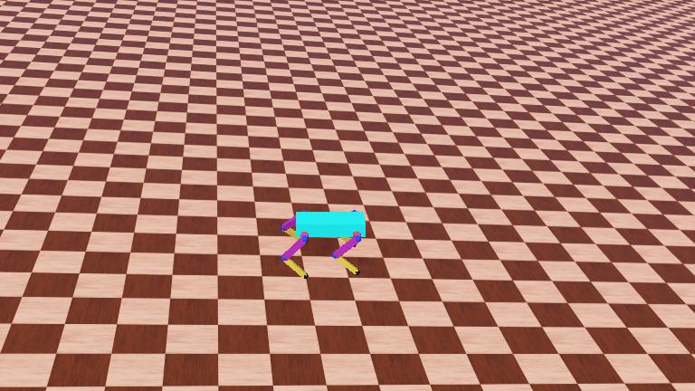
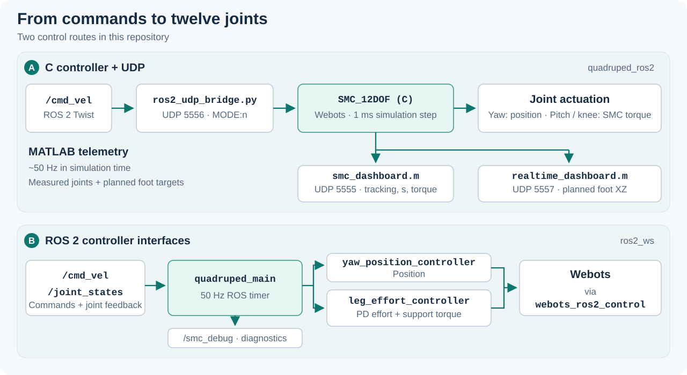
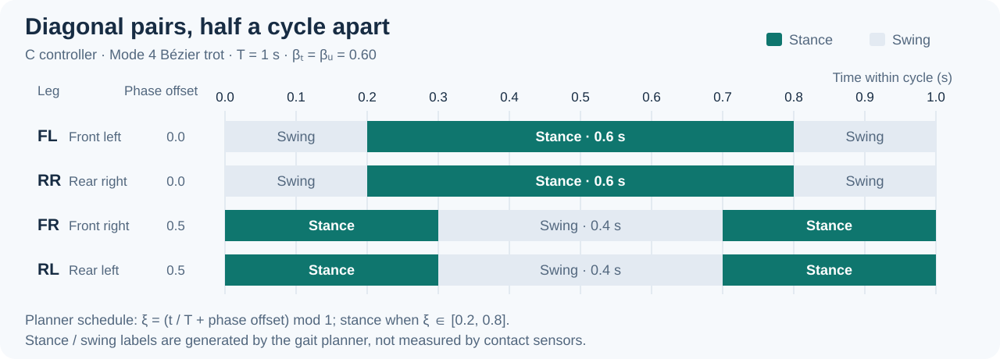

# 12-DOF Quadruped Robot

**Sliding Mode Control · Webots simulation · ROS 2 integration · MATLAB telemetry**

**World format:** Webots R2025a · **ROS distribution:** Humble · **Languages:** C / Python / MATLAB

<a id="english"></a>

**English** · [Tiếng Việt](#tieng-viet)

A four-legged robot simulation for exploring **gait generation, inverse kinematics, and joint control**. Each leg has three actuated joints: hip yaw, hip pitch, and knee pitch.

The main implementation runs a **torque-based Sliding Mode Controller (SMC)** in C inside Webots. ROS 2 selects motion presets through a Python UDP bridge, while MATLAB receives joint and trajectory telemetry. A separate `ros2_ws` package explores control through `webots_ros2_control`.



*Webots simulation screenshot from the repository's existing world preview.*

[Overview](#overview) · [Architecture](#architecture) · [Quick start](#quick-start) · [Motion modes](#motion-modes) · [MATLAB](#matlab-telemetry) · [ROS 2 package](#native-ros2) · [Troubleshooting](#troubleshooting) · [Documentation](#documentation)

<a id="overview"></a>

## Overview

| Component | Implementation |
|---|---|
| Robot | Four legs × three joints = **12 DOF** |
| Main controller | C controller `SMC_12DOF` inside Webots |
| Hybrid actuation | Four yaw joints in position control; eight pitch/knee joints in SMC torque control |
| Control step | **1 ms of simulation time**, nominally 1 kHz |
| Trajectory planning | Degree-6 Bézier curves for Trot and Spin; fixed or sinusoidal targets for other modes |
| Motion presets | **10 modes**, from Stand to Greeting |
| ROS 2 input | `/cmd_vel` → Python bridge → UDP `MODE:n` |
| MATLAB output | Joint tracking/SMC data and planned foot trajectories, nominally **50 Hz of simulation time** |

The C implementation uses two-link inverse kinematics and per-leg Euler–Lagrange dynamics. A saturation boundary layer smooths the SMC switching term, and pitch/knee torque commands are limited to **±5 N·m**.

> The rates above describe configured simulation steps. They are not measured wall-clock performance or a real-time scheduling guarantee.

### Choose a workflow

| Workflow | Folder | Control law | Best starting point |
|---|---|---|---|
| **A - C + UDP** | `quadruped_ros2/` | SMC torque control for pitch/knee, position control for yaw | Explore the implemented SMC controller, all ten presets, and MATLAB dashboards |
| **B - Native ROS 2** | `ros2_ws/` | PD effort control with support torque, position control for yaw | Explore ROS 2 feedback, controller topics, and modular Python code |

The native ROS 2 package currently computes the sliding surface for diagnostics; its effort commands use **PD control**, rather than the C controller's SMC torque law. The two workflows use separate world files and should be launched individually.

<a id="architecture"></a>

## System architecture



For workflow A, the default setup runs Webots, the bridge, and MATLAB on the **same machine**. Command packets go to `127.0.0.1:5556`; telemetry is sent to `127.0.0.1` on two separate ports.

| Port | Direction | Payload | Consumer |
|---|---|---|---|
| `5556` | Bridge or UDP client → Webots | ASCII `MODE:1` … `MODE:10` | C controller |
| `5555` | Webots → MATLAB | CSV: time + 12 values per leg, **49 values total** | `smc_dashboard.m` |
| `5557` | Webots → MATLAB | CSV: time + desired `x,z` per leg, **9 values total** | `realtime_dashboard.m` |

### Repository layout

```text
Quadruped-robot-12DOF/
├── README.md
├── docs/images/                         # README screenshot and diagrams
├── quadruped_ros2/                      # Workflow A: C + UDP
│   ├── Documents/                       # Dynamics, algorithms, and usage notes
│   ├── MATLAB_Scripts/
│   │   ├── smc_dashboard.m              # Joint tracking, error terms, torque
│   │   └── realtime_dashboard.m         # Planned XZ foot trajectories
│   ├── ROS2_Bridge/
│   │   └── ros2_udp_bridge.py           # /cmd_vel → MODE:n
│   └── Webots_Simulation/
│       ├── controllers/SMC_12DOF/       # C controller, math helpers, Makefile
│       └── worlds/                      # World with SMC_12DOF controller
└── ros2_ws/                             # Workflow B: native ROS 2
    └── src/quadruped_ros2/
        ├── quadruped_ros2/              # Planner, IK, state reader, control
        ├── launch/                      # Webots and controller startup
        ├── config/                      # ros2_control configuration
        ├── urdf/                        # Webots ROS 2 interface
        └── worlds/                      # World with external controller
```

<a id="quick-start"></a>

## Quick start - C + UDP

### 1. Prepare the environment

| Dependency | Purpose |
|---|---|
| Ubuntu 22.04 LTS | Linux workflow used by the project; C networking uses POSIX sockets |
| Webots **R2025a** | Both `.wbt` files are saved with this version and reference its PROTO assets |
| C compiler and Make | Build the Webots C controller |
| Python 3 | Direct UDP commands or the ROS 2 bridge |
| ROS 2 Humble | Required only for `/cmd_vel` control through the bridge |
| MATLAB with Java enabled | Optional dashboards; UDP uses Java sockets |

Install ROS 2 and Webots using their official guides: [ROS 2 Humble on Ubuntu](https://docs.ros.org/en/humble/Installation/Ubuntu-Install-Debs.html) and [Webots installation](https://cyberbotics.com/doc/guide/installation-procedure). The repository does not establish compatibility with older Webots releases.

With ROS 2 Humble installed, install the build tools and bridge dependencies:

```bash
sudo apt update
sudo apt install git build-essential ros-humble-rclpy ros-humble-geometry-msgs

git clone https://github.com/TuanLinh05/Quadruped-robot-12DOF.git
cd Quadruped-robot-12DOF
```

The following paths are relative to the repository root unless stated otherwise.

### 2. Open and build the Webots simulation

Open this world in Webots:

```text
quadruped_ros2/Webots_Simulation/worlds/quad_3dof_L1L2L3_4legs.wbt
```

Select the `SMC_12DOF` controller in Webots' editor, build it, then press **Play**. The world selects this controller automatically.

> **Startup behavior:** the C controller starts in **Mode 4 - Trot**. To switch to Stand without ROS 2, send this command while the simulation is running:

```bash
python3 -c "import socket; socket.socket(socket.AF_INET, socket.SOCK_DGRAM).sendto(b'MODE:1', ('127.0.0.1', 5556))"
```

### 3. Start the ROS 2 bridge

In a new terminal, from the repository root:

```bash
source /opt/ros/humble/setup.bash
python3 quadruped_ros2/ROS2_Bridge/ros2_udp_bridge.py
```

The standalone bridge does **not** require building `ros2_ws`.

### 4. Select a motion preset

In another terminal:

```bash
source /opt/ros/humble/setup.bash

# Trot - Mode 4
ros2 topic pub --rate 10 /cmd_vel geometry_msgs/msg/Twist \
  "{linear: {x: 0.5}}"
```

Stop that publisher with `Ctrl+C` before trying another command:

```bash
# Lateral Trot / Crab Walk - Mode 8
ros2 topic pub --rate 10 /cmd_vel geometry_msgs/msg/Twist \
  "{linear: {y: 0.5}}"

# Spin in Place - Mode 9
ros2 topic pub --rate 10 /cmd_vel geometry_msgs/msg/Twist \
  "{angular: {z: 0.5}}"
```

**To request Stand**, stop any motion publisher and send a zero command while the bridge is still running:

```bash
ros2 topic pub --once /cmd_vel geometry_msgs/msg/Twist \
  "{linear: {x: 0.0, y: 0.0, z: 0.0}, angular: {x: 0.0, y: 0.0, z: 0.0}}"
```

The C/UDP workflow retains the last received mode. **`Ctrl+C` alone does not stop the robot**, and the bridge has no command timeout. The direct `MODE:1` UDP command above also requests Stand.

### How the bridge interprets `/cmd_vel`

| Condition, checked in this order | Selected mode |
|---|---|
| `abs(linear.x) > 0.05` | 4 - Trot |
| Otherwise, `abs(linear.y) > 0.05` | 8 - Lateral Trot |
| Otherwise, `abs(angular.z) > 0.05` | 9 - Spin |
| Otherwise | 1 - Stand |

These values **select a preset**. Their magnitude and sign are not forwarded as speed or direction setpoints; combined Twist inputs are resolved using the priority above.

<a id="motion-modes"></a>

## Motion modes

All ten presets are implemented in the C controller. The bridge exposes modes 1, 4, 8, and 9; a direct UDP command can select any mode.

| ID | Mode | Planned motion |
|---|---|---|
| 1 | **Stand** | Hold the nominal foot-height target |
| 2 | **Squat** | Raise the foot targets toward the body |
| 3 | **Belly Dance** | Oscillate all four foot-height targets together |
| 4 | **Trot** | Bézier trajectory with diagonal leg pairs in phase |
| 5 | **Pace** | Same-side leg pairs in phase |
| 6 | **Gallop** | Front/rear phase offsets with sinusoidal lift |
| 7 | **Body Roll Sway** | Alternate left/right heights with yaw motion |
| 8 | **Lateral Trot / Crab Walk** | Diagonal lift pattern with mirrored yaw targets |
| 9 | **Spin in Place** | Opposing left/right Bézier steps with yaw assistance |
| 10 | **Greeting** | Asymmetric support posture with a waving leg |

For example, select Greeting on the same machine as Webots:

```bash
python3 -c "import socket; socket.socket(socket.AF_INET, socket.SOCK_DGRAM).sendto(b'MODE:10', ('127.0.0.1', 5556))"
```

Replace `MODE:10` with any ID from the table. Stop active `/cmd_vel` publishers first, because new bridge packets can overwrite a manual selection.

### Trot phase schedule



For the C Trot preset, the cycle is **1 s**, with a planned stance fraction of **60%**. FL/RR share phase 0; FR/RL share phase 0.5. The planner's contact flags identify planned stance and swing; they are not measured foot-contact events.

### Control model

For each leg's pitch/knee pair, the implementation defines:

$$
e = q_d - q, \qquad s = \dot e + \lambda e
$$

and computes torque using the implemented model terms:

$$
\tau = M(q)(\ddot q_d + \lambda \dot e)
       + c(q,\dot q) + G(q) + J^T F
       + K\,\mathrm{sat}(s,\phi)
$$

Here, $c$ is the Coriolis/centrifugal vector and $F$ is an estimated support force distributed across the planned stance legs. The resulting torques are clipped before actuation.

| C-controller parameter | Value |
|---|---|
| Thigh / shank length | `0.16 m` / `0.16 m` |
| Body mass used for support-force estimate | `1.0 kg` |
| Nominal foot-height target | `−0.22 m` relative to the leg's IK origin |
| Sliding-surface gain `lambda` | `50.0` |
| Switching gain `k_gain` | `2.0` |
| Boundary-layer parameter `phi_smc` | `1.0` |
| Pitch/knee torque limit | `±5.0 N·m` |

Implementation: [`SMC_12DOF.c`](quadruped_ros2/Webots_Simulation/controllers/SMC_12DOF/SMC_12DOF.c) and [`math_utils.c`](quadruped_ros2/Webots_Simulation/controllers/SMC_12DOF/math_utils.c).

<a id="matlab-telemetry"></a>

## MATLAB telemetry

With workflow A running, execute one of these commands in MATLAB from the repository root:

```matlab
% Desired/actual joint angles, error terms, and commanded torque - UDP 5555
run('quadruped_ros2/MATLAB_Scripts/smc_dashboard.m')

% Planned XZ trajectories for all four feet - UDP 5557
run('quadruped_ros2/MATLAB_Scripts/realtime_dashboard.m')
```

Use **separate MATLAB sessions** to keep both dashboards open: each script starts with `clear` and `close all`. Their Java socket implementation does not require Instrument Control Toolbox for UDP reception.

The SMC payload groups data in **FL, FR, RL, RR** order. Each leg contributes:

```text
q_yaw_desired, q_yaw_actual,
q_pitch_desired, q_pitch_actual,
q_knee_desired, q_knee_actual,
yaw_position_error, s_pitch, s_knee,
0, torque_pitch, torque_knee
```

Yaw uses position control, so its torque field is a zero placeholder. The trajectory dashboard receives **desired XZ coordinates**, rather than measured 3D foot positions. Its fixed axes may need adjustment for Squat or Greeting.

<a id="native-ros2"></a>

## Native ROS 2 package - experimental workflow

This route uses the world under `ros2_ws`, an external Webots controller, and ROS 2 control interfaces. It does not use the standalone UDP bridge or its MATLAB telemetry stream.

### Build and launch

With ROS 2 Humble and Webots installed, prepare `colcon` and `rosdep`:

```bash
sudo apt install python3-colcon-common-extensions python3-rosdep
```

If `rosdep` has never been initialized on this machine, run `sudo rosdep init` once. Then, from the repository root:

```bash
source /opt/ros/humble/setup.bash
rosdep update
cd ros2_ws
rosdep install --from-paths src --ignore-src --rosdistro humble -y
colcon build --symlink-install --packages-select quadruped_ros2
source install/setup.bash
ros2 launch quadruped_ros2 quadruped_webots.launch.py
```

The launch file starts Webots and the joint controllers. **`quadruped_main` is currently excluded from the launch description**, so start it separately in a second terminal from the repository root:

```bash
source /opt/ros/humble/setup.bash
cd ros2_ws
source install/setup.bash
ros2 run quadruped_ros2 quadruped_main
```

In a third terminal, request Trot:

```bash
source /opt/ros/humble/setup.bash
ros2 topic pub --rate 10 /cmd_vel geometry_msgs/msg/Twist \
  "{linear: {x: 0.03}}"
```

### ROS interfaces

| Topic | Message | Role |
|---|---|---|
| `/cmd_vel` | `geometry_msgs/msg/Twist` | Motion input |
| `/joint_states` | `sensor_msgs/msg/JointState` | Joint feedback |
| `/yaw_position_controller/commands` | `std_msgs/msg/Float64MultiArray` | Four yaw position targets |
| `/leg_effort_controller/commands` | `std_msgs/msg/Float64MultiArray` | Eight pitch/knee effort commands |
| `/smc_debug` | `std_msgs/msg/Float64MultiArray` | Mode, phase, maximum absolute error, maximum absolute sliding surface |

The Python node uses a **50 Hz ROS timer** and a **0.5 s command timeout**; the controller manager is configured at **100 Hz**. Lateral and Spin are experimental yaw-motion modes. Full 3D foot inverse kinematics and verified sideways/turning performance are not established by this implementation.

Configuration and control code: [`robot_config.py`](ros2_ws/src/quadruped_ros2/quadruped_ros2/robot_config.py), [`hybrid_command.py`](ros2_ws/src/quadruped_ros2/quadruped_ros2/hybrid_command.py), and [`ros2_controllers.yaml`](ros2_ws/src/quadruped_ros2/config/ros2_controllers.yaml).

<a id="troubleshooting"></a>

## Troubleshooting

| Symptom | What to check |
|---|---|
| Robot keeps moving after `Ctrl+C` in workflow A | Send the explicit zero Twist while the bridge is running, or direct UDP `MODE:1` |
| Bridge runs, but the C mode does not change | Use workflow A's world, press Play, and check UDP port `5556`; the bridge targets localhost |
| `BIND PORT 5556` fails | Close the other C-controller simulation holding the same port |
| ROS 2 world opens, but no gait commands are generated | Start `ros2 run quadruped_ros2 quadruped_main` in a sourced terminal |
| MATLAB has no data | Use port `5555` for SMC and `5557` for trajectories; run workflow A and check that the port is free |
| MATLAB reports a socket error | Use a Java-enabled MATLAB session and close any dashboard already bound to that port |
| C controller does not build on native Windows | Its networking uses POSIX headers; use the documented Linux route or port the socket code |
| A guide contains `Version/Version 2 (ROS2)` paths | Those are older layouts; use the current paths in this README |

### Current scope

This repository focuses on **simulation and controller experiments**. The dynamics are computed per leg, support-force estimates use planned contact flags, and the standalone bridge selects fixed presets. Hardware testing, autonomous navigation, and quantitative performance benchmarks remain outside the documented scope.

<a id="documentation"></a>

## Documentation

| Resource | Contents |
|---|---|
| [Euler–Lagrange derivation](quadruped_ros2/Documents/Euler_Lagrange_Derivation.md) | Per-leg inertia, Coriolis, and gravity terms |
| [Algorithm mathematics](quadruped_ros2/Documents/Algorithm_Math.md) | Bézier curves, inverse kinematics, and SMC concepts |
| [Project analysis](quadruped_ros2/Documents/Project_Analysis.md) | Background notes on the project |
| [Usage notes](quadruped_ros2/Documents/ROS2_Webots_Usage_Guide.md) | Historical setup notes; use this README for current paths, mode commands, and stopping behavior |
| [C implementation](quadruped_ros2/Webots_Simulation/controllers/SMC_12DOF/SMC_12DOF.c) | Current mode logic, control law, and telemetry format |
| [ROS 2 main node](ros2_ws/src/quadruped_ros2/quadruped_ros2/main.py) | Native package feedback and command loop |

Related project: [ROS2_Webots_DOG](https://github.com/TuanLinh05/ROS2_Webots_DOG).

---

<a id="tieng-viet"></a>

## Tiếng Việt

[English](#english) · **Tiếng Việt**

### Giới thiệu

Dự án mô phỏng **robot bốn chân 12 bậc tự do** trong Webots, phục vụ học tập và thử nghiệm điều khiển robot. Mỗi chân có ba khớp: **hip yaw, hip pitch và knee pitch**.

Luồng chính sử dụng controller **C với Sliding Mode Control theo mô-men** cho khớp pitch/gối và điều khiển vị trí cho khớp yaw. ROS 2 gửi lệnh chọn chế độ qua cầu nối UDP; MATLAB hiển thị dữ liệu khớp và quỹ đạo bàn chân.

Ảnh ở đầu README là ảnh Webots có sẵn trong repo. Hai sơ đồ minh họa kiến trúc điều khiển và lịch pha Trot được dựng từ mã nguồn.

### Hai cách chạy

| Luồng | Thư mục | Nội dung |
|---|---|---|
| **A - C + UDP** | `quadruped_ros2/` | SMC, 10 chế độ chuyển động, hai dashboard MATLAB |
| **B - ROS 2 native** | `ros2_ws/` | Điều khiển qua `webots_ros2_control`, PD mô-men và dữ liệu phản hồi ROS 2 |

Package ROS 2 native hiện tính mặt trượt để theo dõi; lệnh mô-men vẫn dùng **PD kết hợp mô-men hỗ trợ**. Chạy từng luồng với world tương ứng.

### Chạy nhanh luồng C + UDP

Môi trường sử dụng: **Ubuntu 22.04, Webots R2025a, trình biên dịch C, Python 3**. ROS 2 Humble cần cho cầu nối `/cmd_vel`; MATLAB là tùy chọn. Các world trong repo khai báo R2025a, chưa có cơ sở xác nhận hỗ trợ bản Webots cũ hơn.

1. Clone repo và mở world:

   ```bash
   git clone https://github.com/TuanLinh05/Quadruped-robot-12DOF.git
   cd Quadruped-robot-12DOF
   ```

   ```text
   quadruped_ros2/Webots_Simulation/worlds/quad_3dof_L1L2L3_4legs.wbt
   ```

2. Build controller `SMC_12DOF` trong Webots rồi nhấn **Play**. Controller mặc định khởi động ở **Trot - Mode 4**. Muốn chuyển về Stand ngay, gửi:

   ```bash
   python3 -c "import socket; socket.socket(socket.AF_INET, socket.SOCK_DGRAM).sendto(b'MODE:1', ('127.0.0.1', 5556))"
   ```

3. Ở terminal mới, từ thư mục gốc repo, chạy bridge:

   ```bash
   source /opt/ros/humble/setup.bash
   python3 quadruped_ros2/ROS2_Bridge/ros2_udp_bridge.py
   ```

4. Ở terminal khác, gửi lệnh Trot:

   ```bash
   source /opt/ros/humble/setup.bash
   ros2 topic pub --rate 10 /cmd_vel geometry_msgs/msg/Twist \
     "{linear: {x: 0.5}}"
   ```

   Dùng `linear.y: 0.5` để chọn **Mode 8 - Lateral Trot**, hoặc `angular.z: 0.5` để chọn **Mode 9 - Spin**. Dừng publisher trước khi gửi một lệnh khác.

5. **Để chuyển về Stand**, dừng publisher bằng `Ctrl+C`, giữ bridge đang chạy rồi gửi:

   ```bash
   ros2 topic pub --once /cmd_vel geometry_msgs/msg/Twist \
     "{linear: {x: 0.0, y: 0.0, z: 0.0}, angular: {x: 0.0, y: 0.0, z: 0.0}}"
   ```

**Lưu ý:** `Ctrl+C` không tự đưa luồng C + UDP về Stand. Controller giữ mode cuối cùng; bridge chưa có timeout mất lệnh. Lệnh `/cmd_vel` ở luồng này chỉ chọn preset, không điều chỉnh tốc độ hoặc chiều chuyển động theo độ lớn và dấu. Thứ tự ưu tiên là `linear.x` → `linear.y` → `angular.z`, với ngưỡng trị tuyệt đối `0.05`.

### Chế độ và dữ liệu theo dõi

Controller C có **10 mode**: Stand, Squat, Belly Dance, Trot, Pace, Gallop, Body Roll Sway, Lateral Trot/Crab Walk, Spin và Greeting. Xem [bảng mode](#motion-modes) để biết ID; gửi trực tiếp `MODE:n` qua UDP `5556` để chọn bất kỳ mode nào.

| Thành phần | Cổng / chu kỳ | Dữ liệu |
|---|---|---|
| Controller C | Bước mô phỏng `1 ms` | SMC cho pitch/gối, vị trí cho yaw |
| `smc_dashboard.m` | UDP `5555`, khoảng 50 Hz theo thời gian mô phỏng | Góc đặt/thực, sai số, mặt trượt pitch/gối và mô-men lệnh |
| `realtime_dashboard.m` | UDP `5557`, khoảng 50 Hz theo thời gian mô phỏng | Tọa độ **XZ đặt** của bốn bàn chân |

Chạy dashboard từ thư mục gốc repo trong MATLAB:

```matlab
run('quadruped_ros2/MATLAB_Scripts/smc_dashboard.m')
% Hoặc:
run('quadruped_ros2/MATLAB_Scripts/realtime_dashboard.m')
```

Muốn xem đồng thời cả hai, dùng hai phiên MATLAB riêng vì các script đều gọi `close all`. MATLAB cần bật Java; phần nhận UDP không cần Instrument Control Toolbox. Tọa độ bàn chân được gửi là quỹ đạo đặt, chưa phải vị trí 3D đo được.

### Chạy package ROS 2 native

Sau khi cài ROS 2 Humble, Webots, `colcon` và khởi tạo `rosdep`, tại thư mục gốc repo:

```bash
source /opt/ros/humble/setup.bash
rosdep update
cd ros2_ws
rosdep install --from-paths src --ignore-src --rosdistro humble -y
colcon build --symlink-install --packages-select quadruped_ros2
source install/setup.bash
ros2 launch quadruped_ros2 quadruped_webots.launch.py
```

Ở terminal thứ hai, từ thư mục gốc repo:

```bash
source /opt/ros/humble/setup.bash
cd ros2_ws
source install/setup.bash
ros2 run quadruped_ros2 quadruped_main
```

Node `quadruped_main` chưa được bật trong launch nên cần chạy riêng. Gửi `/cmd_vel` liên tục với `--rate 10`; ví dụ `linear.x: 0.03` cho Trot. Node Python có timer **50 Hz** và timeout lệnh **0.5 s**. Hai mode ngang/xoay ở package này vẫn là thử nghiệm chuyển động yaw, chưa triển khai đầy đủ IK bàn chân 3D.

Xem [giao diện ROS 2](#native-ros2), [xử lý lỗi](#troubleshooting) và [tài liệu toán học](#documentation) để đọc thêm. Hướng dẫn cũ còn có đường dẫn `Version/Version 2 (ROS2)`, ánh xạ mode và cách dừng đã lỗi thời; hãy dùng README này cho lệnh chạy và dừng hiện tại.

---

<p align="center">Developed by <a href="https://github.com/TuanLinh05">Vu Tuan Linh</a> · HCMUT</p>
